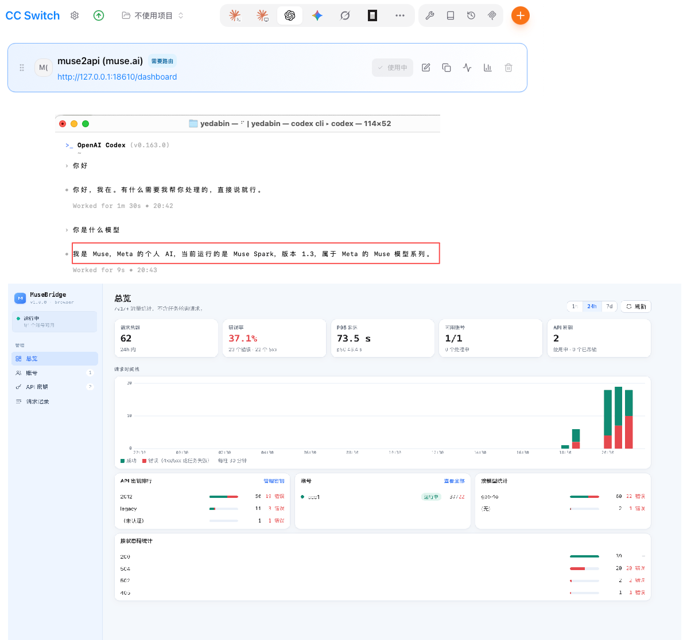

<p align="center">
  
</p>

<h1 align="center">MuseBridge</h1>

<p align="center">
  面向 CC Switch 与 Codex CLI 的 Muse AI 开源 API 反向代理工具<br>
  An open-source Muse AI API reverse proxy for CC Switch and Codex CLI
</p>

<p align="center">
  
  
  
  
</p>

<p align="center">
  <strong>简洁 · 开源 · 易于管理</strong>
</p>

<p align="center">
  🙏 感谢 <a href="https://linux.do">linux.do</a> 社区 · 本项目首发于 <a href="https://linux.do">linux.do</a>
</p>

---

## 📖 目录 / Contents

- [界面截图 / Screenshot](#界面截图--screenshot)
- [简体中文](#简体中文)
  - [项目简介](#项目简介)
  - [功能特性](#功能特性)
  - [支持的客户端](#支持的客户端)
  - [管理面板](#管理面板)
  - [快速开始](#快速开始)
  - [安全建议](#安全建议)
  - [免责声明](#免责声明)
- [English](#english)
  - [Introduction](#introduction)
  - [Features](#features)
  - [Supported Clients](#supported-clients)
  - [Getting Started](#getting-started)
  - [Security](#security)
  - [Disclaimer](#disclaimer)

---

## 界面截图 / Screenshot

<p align="center">
  
</p>

<p align="center">
  CC Switch 中配置 MuseBridge 供应商 · Codex CLI 通过代理对话 · MuseBridge Web 管理面板<br>
  MuseBridge provider in CC Switch · Codex CLI chatting through the proxy · the MuseBridge web dashboard
</p>

---

## 简体中文

### 项目简介

MuseBridge 是一个面向开发者的 Muse AI API 反向代理项目。

通过 MuseBridge，开发者可以在受支持的客户端中配置代理 API 地址，并使用 Web 管理面板管理 API 密钥、查看请求记录和监控服务运行情况。

项目致力于简化 Muse AI 与开发工具之间的 API 接入流程，提供轻量化、直观且便于自行部署的管理体验。

### 功能特性

- **Muse AI API 反向代理**：通过统一的接口转发 API 请求。
- **CC Switch 支持**：支持在兼容的 CC Switch 使用场景中配置和管理 API 接入。
- **Codex CLI 支持**：支持将 Muse AI API 接入 Codex CLI 客户端。
- **工具调用（模拟）**：通过提示词模拟 OpenAI function calling——请求中的 `tools` 注入提示词，模型按约定格式输出调用，再翻译回标准 `tool_calls`。尽力而为，可用 `MUSE2API_TOOL_EMULATION=false` 关闭。
- **账号管理**：通过 Web 管理面板管理已配置的账号。
- **浏览器登录添加账号**：面板内一键打开登录窗口，登录 muse.ai 后自动抓取全部会话 Cookie（含 HttpOnly 项，如 hatch_gw）并入池；同一账号重新登录会自动刷新原账号，无需再从开发者工具复制。需服务器有图形界面。
- **API 密钥管理**：管理代理服务的 API 访问密钥。
- **请求监控**：查看请求数量、错误率和响应延迟等统计数据。
- **模型使用统计**：查看已有的模型请求统计信息。
- **请求日志**：查询已有请求记录，便于排查和分析问题。
- **可视化管理面板**：通过简洁的 Web 界面查看服务状态和运行数据。

具体功能及支持范围以当前代码版本和实际部署情况为准。

### 支持的客户端

#### CC Switch

MuseBridge 可用于支持自定义 API 配置的 CC Switch 使用场景。在 CC Switch 的 Codex 分栏中添加自定义供应商，填入：

- **Base URL**：`http://127.0.0.1:18610/v1`
- **API Key**：在 MuseBridge 管理面板中创建（`m2a-` 开头）
- **模型**：`gpt-4o` 等别名（以 `GET /v1/models` 返回为准）

#### Codex CLI

在 `~/.codex/config.toml` 中添加自定义供应商：

```toml
model = "gpt-4o"
model_provider = "musebridge"

[model_providers.musebridge]
name = "MuseBridge"
base_url = "http://127.0.0.1:18610/v1"
wire_api = "chat"
```

并将环境变量 `OPENAI_API_KEY` 设置为管理面板中创建的 API 密钥。

> **注意**：MuseBridge 提供 OpenAI 兼容的对话接口（支持流式与非流式）以及图片、视频生成接口。工具调用（tool use / function calling）通过提示词模拟实现：`tools` 定义注入提示词，模型按约定标记格式输出调用意图，代理再翻译回标准 `tool_calls`，Codex CLI 的 agent 工具调用（执行命令、修改文件等）即基于此机制，属尽力而为——模型偶尔不按格式时会降级为普通文字回复（可用 `MUSE2API_TOOL_EMULATION=false` 关闭）；web_search 等客户端专有端点不在支持范围。不同客户端对 API 协议、认证方式和模型参数的要求可能不同。

### 管理面板

MuseBridge 提供 Web 管理面板（默认 `http://127.0.0.1:18610/dashboard`），用于查看和管理代理服务：

| 模块 | 说明 |
|---|---|
| 总览 | 请求量、错误率、响应延迟、按模型统计等 |
| 账号 | 管理 muse.ai 账号（浏览器登录自动获取、添加 / 编辑 Cookie、启用停用、续期） |
| API 密钥 | 管理客户端调用密钥 |
| 请求记录 | 查看已有请求日志 |

管理面板的具体功能以当前版本为准。

### 快速开始

**环境要求**：Python 3.10+、Google Chrome 或 Chromium（浏览器驱动使用）、muse.ai 账号。

```bash
git clone https://github.com/DaBinBinah/muse-bridge.git
cd muse-bridge

python3 -m venv .venv && source .venv/bin/activate
pip install -e .

cp .env.example .env
# 编辑 .env，把 MUSE2API_DRIVER 改为 browser 以接入真实 muse.ai
# （mock 为离线模式，无需 Chrome 与账号，返回固定假回复）
sed -i '' 's/^MUSE2API_DRIVER=mock/MUSE2API_DRIVER=browser/' .env   # macOS
# Linux: sed -i 's/^MUSE2API_DRIVER=mock/MUSE2API_DRIVER=browser/' .env
python -m muse2api        # 默认监听 http://127.0.0.1:18610
```

启动后访问 [http://127.0.0.1:18610/dashboard](http://127.0.0.1:18610/dashboard) 进入管理面板。首次启动会自动生成 API Key 并保存在 `data/api_key`，同时作为管理面板密钥。

**添加 muse.ai 账号（推荐）**：管理面板「账号」页点击**浏览器登录**，在弹出的窗口中完成登录，Cookie 会自动抓取并入池。也可以手动添加：在浏览器登录 muse.ai 后，从开发者工具中获取 `hatch_sess`、`hatch_gw`、`hatch_vml`、`hatch_native_auth_device` 四个 Cookie，在管理面板「账号」页点击**添加账号**逐项填入或整段粘贴 `Cookie` 请求头；还可以通过管理 API 导入：

```bash
curl http://127.0.0.1:18610/admin/accounts \
  -H "Authorization: Bearer <ADMIN_KEY>" -H "Content-Type: application/json" \
  -d '{"label":"acc1","cookies":{"hatch_sess":"...","hatch_gw":"...","hatch_vml":"...","hatch_native_auth_device":"..."}}'
```

**测试请求**：

```bash
curl http://127.0.0.1:18610/v1/chat/completions \
  -H "Authorization: Bearer <API_KEY>" -H "Content-Type: application/json" \
  -d '{"model":"gpt-4o","messages":[{"role":"user","content":"Hello"}]}'
```

### 安全建议

为确保代理服务安全运行，建议：

- 不要将 API 密钥、访问令牌或其他敏感凭据提交到公开仓库。
- 为管理面板设置安全的访问控制。
- 不要在未经授权的情况下公开代理服务。
- 生产环境建议使用 HTTPS。
- 定期检查请求日志和异常访问情况。
- 妥善保管上游账号及认证信息。
- 遵守 Muse AI 及相关服务的使用条款。

### 免责声明

MuseBridge 是一个开源技术项目，主要用于 API 接入、请求转发和服务管理。

- 本项目与 Muse AI、CC Switch 及 OpenAI 均无官方隶属或合作关系，除非另有明确说明。
- 用户应自行确保其使用方式符合相关服务的使用条款及适用法律法规。
- 用户应对自己的部署、配置、凭据保管及使用行为负责。
- 请勿将本项目用于未经授权的访问或其他违法用途。

---

## English

### Introduction

MuseBridge is an open-source API reverse proxy and management tool for Muse AI.

It provides a unified API access layer and a web-based dashboard for managing accounts, API keys, request logs, and usage statistics.

MuseBridge aims to simplify the integration of Muse AI with developer tools, including CC Switch and Codex CLI, while providing a lightweight and self-hostable management experience.

### Features

- **Muse AI API Proxy** — Forward API requests through a unified interface.
- **CC Switch Support** — Configure API access for compatible CC Switch workflows.
- **Codex CLI Support** — Connect Muse AI API access to the Codex CLI client.
- **Emulated Tool Calling** — OpenAI `tools` are described in the prompt and the marker-formatted reply is translated back into standard `tool_calls`. Best-effort (muse.ai has no native function calling); disable with `MUSE2API_TOOL_EMULATION=false`.
- **Account Management** — Manage configured accounts through a web dashboard.
- **In-Dashboard Browser Login** — open a login window from the dashboard; after signing in to muse.ai, all session cookies (HttpOnly included, e.g. `hatch_gw`) are captured automatically and the account is created or refreshed. No more copying cookies from devtools. Requires a GUI on the server.
- **API Key Management** — Manage API keys used to access the proxy.
- **Request Monitoring** — View request counts, error rates, and response latency.
- **Model Usage Statistics** — Review available model usage statistics.
- **Request Logs** — Inspect recorded API requests for troubleshooting.
- **Web Dashboard** — Monitor service status and API activity through a clean interface.

Available features and compatibility depend on the current code version and deployment configuration.

### Supported Clients

#### CC Switch

MuseBridge can be used with compatible CC Switch workflows that support custom API configuration. Add a custom provider in the Codex section of CC Switch with:

- **Base URL**: `http://127.0.0.1:18610/v1`
- **API Key**: created in the MuseBridge dashboard (prefixed with `m2a-`)
- **Model**: `gpt-4o` or other aliases (see `GET /v1/models`)

#### Codex CLI

Add a custom provider to `~/.codex/config.toml`:

```toml
model = "gpt-4o"
model_provider = "musebridge"

[model_providers.musebridge]
name = "MuseBridge"
base_url = "http://127.0.0.1:18610/v1"
wire_api = "chat"
```

Then set the `OPENAI_API_KEY` environment variable to an API key created in the dashboard.

> **Note**: MuseBridge exposes OpenAI-compatible chat endpoints (streaming and non-streaming) plus image and video generation endpoints. Tool calling is emulated at the prompt level: `tools` from the request are injected into the prompt and the model's marker-formatted reply is converted back into standard `tool_calls`. This is best-effort — a reply that does not follow the format degrades to plain text (turn it off with `MUSE2API_TOOL_EMULATION=false`). Agentic tool calling in Codex CLI (running commands, editing files) works on top of this emulation; proprietary endpoints such as web search are out of scope. API protocols, authentication methods, and model parameters may vary between clients.

### Getting Started

**Requirements**: Python 3.10+, Google Chrome or Chromium (used by the browser driver), and a muse.ai account.

```bash
git clone https://github.com/DaBinBinah/muse-bridge.git
cd muse-bridge

python3 -m venv .venv && source .venv/bin/activate
pip install -e .

cp .env.example .env
# Edit .env and set MUSE2API_DRIVER=browser to talk to the real muse.ai
# (mock is an offline mode: no Chrome or account needed, canned replies)
sed -i 's/^MUSE2API_DRIVER=mock/MUSE2API_DRIVER=browser/' .env      # Linux (macOS: sed -i '')
python -m muse2api        # listens on http://127.0.0.1:18610 by default
```

Open [http://127.0.0.1:18610/dashboard](http://127.0.0.1:18610/dashboard) for the management dashboard. On first start an API key is generated and stored in `data/api_key`; it also acts as the dashboard admin key.

**Add a muse.ai account (recommended)**: click **Browser login** on the dashboard's Accounts page and sign in inside the window that opens — the cookies are captured automatically. Alternatively, collect the `hatch_sess`, `hatch_gw`, `hatch_vml`, and `hatch_native_auth_device` cookies from the developer tools of a signed-in browser and use the **Add account** button — fill in each value or paste the whole `Cookie` header. You can also import via the admin API:

```bash
curl http://127.0.0.1:18610/admin/accounts \
  -H "Authorization: Bearer <ADMIN_KEY>" -H "Content-Type: application/json" \
  -d '{"label":"acc1","cookies":{"hatch_sess":"...","hatch_gw":"...","hatch_vml":"...","hatch_native_auth_device":"..."}}'
```

**Test request**:

```bash
curl http://127.0.0.1:18610/v1/chat/completions \
  -H "Authorization: Bearer <API_KEY>" -H "Content-Type: application/json" \
  -d '{"model":"gpt-4o","messages":[{"role":"user","content":"Hello"}]}'
```

### Security

For a secure deployment:

- Never commit API keys, access tokens, or other sensitive credentials to a public repository.
- Protect access to the management dashboard.
- Avoid exposing the proxy service publicly without appropriate access controls.
- Use HTTPS in production environments.
- Review request logs for unusual activity.
- Keep upstream account credentials secure.
- Follow the applicable terms of service for Muse AI and related services.

### Disclaimer

MuseBridge is an open-source technical project intended for API integration, request forwarding, and service management.

- This project is not officially affiliated with or endorsed by Muse AI, CC Switch, or OpenAI unless explicitly stated otherwise.
- Users are responsible for ensuring that their use complies with applicable terms of service and laws.
- Users are responsible for their deployment, configuration, credential security, and usage.
- Do not use this project for unauthorized access or unlawful activities.

---

<p align="center">
  <strong>MuseBridge</strong><br>
  Bridging Muse AI with developer tools.
</p>

## License / 许可证

[MIT](LICENSE)
